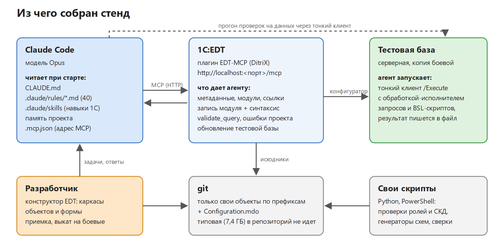
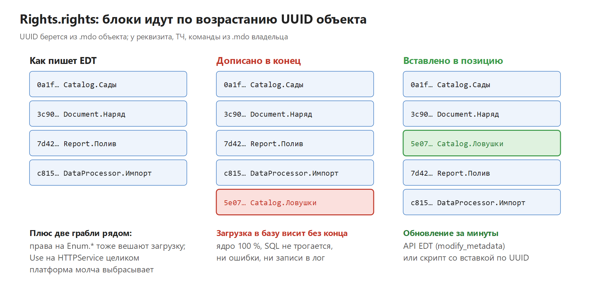

# Claude Code + 1C:EDT: правила, шаблоны и проверки

[](https://infostart.ru/1c/articles/2815822/)

Набор для тех, кто подключает ИИ-агента (Claude Code) к проекту 1С в EDT. Все это вышло из трех месяцев работы агента в живом проекте 1С:Бухгалтерии КОРП 3.0: 328 коммитов, десятки отчетов на СКД, документы, регистры, обмены. Почти каждое правило здесь появилось после аварии: падения конфигуратора, зависшего обновления базы, «чистой» валидации EDT при падающей платформе.

Материалы к публикациям на Инфостарте:

- [Claude Code + EDT на БП КОРП: три месяца, 328 коммитов и 40 правил, написанных падениями конфигуратора](https://infostart.ru/1c/articles/2815822/): основная статья, шаблоны и скрипты из этого репозитория
- [Четыре дня зависшего обновления конфигурации: порядок блоков в Rights.rights](https://infostart.ru/1c/articles/2815862/): подробный разбор, к ней относится `scripts/check_rights_order.py`



## Что внутри

| Файл | Зачем |
|---|---|
| [templates/CLAUDE.md](templates/CLAUDE.md) | стартовый CLAUDE.md для EDT-проекта: запреты, рабочий цикл, диагностика |
| [templates/rule-template.md](templates/rule-template.md) | шаблон правила: симптом, причина, рецепт, ложные направления, проверка |
| [templates/checklist-before-db-update.md](templates/checklist-before-db-update.md) | что проверить до «Обновить конфигурацию базы данных» и что делать, если обновление висит |
| [templates/mcp.json.example](templates/mcp.json.example) | подключение Claude Code к плагину EDT-MCP |
| [templates/gitignore.example](templates/gitignore.example) | git для проекта на типовой: только свои объекты по префиксам и `Configuration.mdo` |
| [scripts/check_rights_order.py](scripts/check_rights_order.py) | проверка ролей: порядок блоков в `Rights.rights` по UUID, права на `Enum.*`, права на HTTP-сервис целиком |
| [scripts/check_dcs_nodes.py](scripts/check_dcs_nodes.py) | проверка схем СКД после правки скриптом: `<title>` без `xsi:type`, разнобой однотипных узлов, порядок `<appearance>` |
| [schemes/](schemes/) | схемы из статьи (PNG и SVG) |

## Быстрый старт

1. Поставить в EDT плагин EDT-MCP (DitriX), update site `https://ditrixnew.github.io/EDT-MCP/`. В Preferences, MCP Server, Destructive operations решить, что агенту разрешено без подтверждения: иначе переименования падают по таймауту.
2. Положить `templates/mcp.json.example` в корень рабочего каталога как `.mcp.json`, поправить порт.
3. Положить `templates/CLAUDE.md` в корень проекта, заменить префиксы и описание конфигурации.
4. Перед каждым обновлением тестовой базы прогонять скрипты:

```bash
python scripts/check_rights_order.py <путь к src EDT-проекта> [Роль1 Роль2 ...]
python scripts/check_dcs_nodes.py <папка src/Reports или файл Template.dcs>
```

Скрипты на Python 3, только стандартная библиотека. Код возврата 1, если есть замечания, так что их можно ставить в pre-commit или CI.

## Почему проверка ролей

Блок `<object>`, дописанный в конец `Rights.rights`, ломает порядок по UUID. EDT ошибок не показывает, а загрузка конфигурации в базу висит без конца: ядро на 100 %, ни ошибки, ни записи в лог. У нас это стоило четыре дня.



## Лицензия

MIT. Берите в свои проекты, правьте под себя. Если найдете еще случаи, когда EDT молчит, а платформа падает, присылайте issue или pull request: добавлю в проверки.
